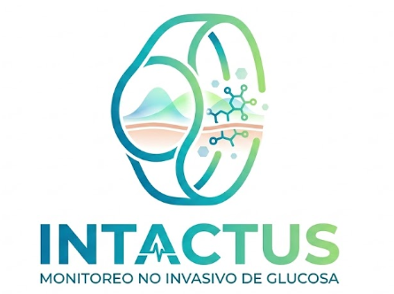

# INTACTUS - Sistema de Monitoreo Continuo y No Invasivo de Glucosa

**INTACTUS** *(del latín "intacto / no tocado")* es una solución tecnológica biomédica integral diseñada para monitorear los niveles de glucosa en sangre en tiempo real de forma **100% no invasiva**, eliminando la necesidad de punciones capilares y parches subcutáneos desechables.

### Caracteristicas de INTACTUS:
1. Sin Pinchazos ni dolores o incomodidad.
2. Monitorieo de la glucosa continuo.
3. SIstema de alertas en caso de alguna potencial crisis hipoglucemica.
4. a largo plazo es una excelente inversion ademas de evitar la contaminacion que generar los sistemas de monitoreo comunes.

